<p align="center">
  
</p>

<h1 align="center">Kento</h1>

<p align="center">
  <strong>Drag a file, press a key, drop it on the dial.</strong><br>
  Free, open-source file conversion and tools for Windows and macOS, done on your own computer.
</p>

<p align="center">
  <a href="https://github.com/MehmetBurakTaskaya/kento/releases/latest"></a>
  <a href="https://github.com/MehmetBurakTaskaya/kento/releases"></a>
  <a href="LICENSE"></a>
  <a href="#download"></a>
</p>

<p align="center">
  
</p>

<p align="center">
  <strong>The small jobs you would otherwise look for a website to do, on your own computer:</strong><br>
  a HEIC photo to JPG, the best part of a video cut out and made vertical, a podcast's sound evened
  out, a face or a number plate hidden, the video behind a link saved, slides turned into a PDF.
</p>

<p align="center">
  <a href="https://github.com/MehmetBurakTaskaya/kento/releases/latest/download/Kento-Windows-x64-Setup.exe"></a>
  <a href="https://github.com/MehmetBurakTaskaya/kento/releases/latest/download/Kento-Windows-x64-Portable.zip"></a>
  <a href="https://github.com/MehmetBurakTaskaya/kento/releases/latest/download/Kento-macOS-Universal.dmg"></a>
</p>

<p align="center">
  Windows 10 (1809 or later) and 11, x64 · macOS 13 or later, Apple silicon and Intel<br>
  <a href="README.tr.md">Türkçe</a> · <a href="CHANGELOG.md">Changelog</a> ·
  By <a href="https://mehmetburaktaskaya.com">Mehmet Burak Taşkaya</a>
</p>

While you drag a file in Explorer, Finder or any other app, press **Shift**: a steel safe dial
opens under the pointer. Drop the file on a slice and Kento converts it on the spot, into a new
copy next to the original. **Ctrl** (⌘ on a Mac) opens the tools instead and **Alt** (⌃) the file
actions. Nothing is uploaded anywhere, and the original stays as it was.

## What it does

Every job runs on your computer and writes a new file next to the original.

**Video**

- **Cut:** keep the part you want, cut out the parts you mark, take the pauses out of someone
  speaking, or split a video at your markers, into equal parts or every few seconds.
- **Make it vertical:** a 1080 × 1920 video for shorts and stories, cropped where you choose or laid
  over a blurred copy of itself; or crop to 1:1, 4:5, 16:9 or any area you draw.
- **Sound:** add music under the voice (it steps back while someone speaks) or in place of the
  sound, fade in and out, make it louder or quieter, remove noise, or take the sound away.
- **Add:** text in four typefaces and your logo, each where and when you want it; join clips with a
  fade, a slide or a wipe; burn in subtitles.
- **Change:** play it from 0.25× to 4× with the voice at its own pitch, backwards, as a boomerang or
  on a loop; turn or mirror it; give it a look or adjust its colors; steady a shaky video.
- **Hide:** blur, pixelate or cover faces, number plates and logos, each only for the seconds it is
  on screen, or erase a date stamp or a mark of your own.
- **And:** save frames as pictures, make a GIF, take out the MP3, convert between MP4, MOV, MKV and
  WEBM, and compress to a size such as "under 25 MB".

**Audio**

- **Even out the loudness** for a podcast, a music service or broadcast (EBU R128), measured first
  and applied in a second pass.
- **Edit:** keep the part you want, cut out parts or the pauses, fade in and out, change the
  volume, remove hiss and hum, make it mono or stereo or balance left and right, and bleep or mute
  words.
- **Join** recordings with a crossfade, and **make a ringtone** of up to 40 seconds as M4R or MP3.
- **Make a video of it:** a waveform, a spectrum, bars or a picture, ready to post.
- **Convert** between MP3, M4A, WAV, FLAC, OGG, OPUS and more, or compress it.

<table>
  <tr>
    <td align="center">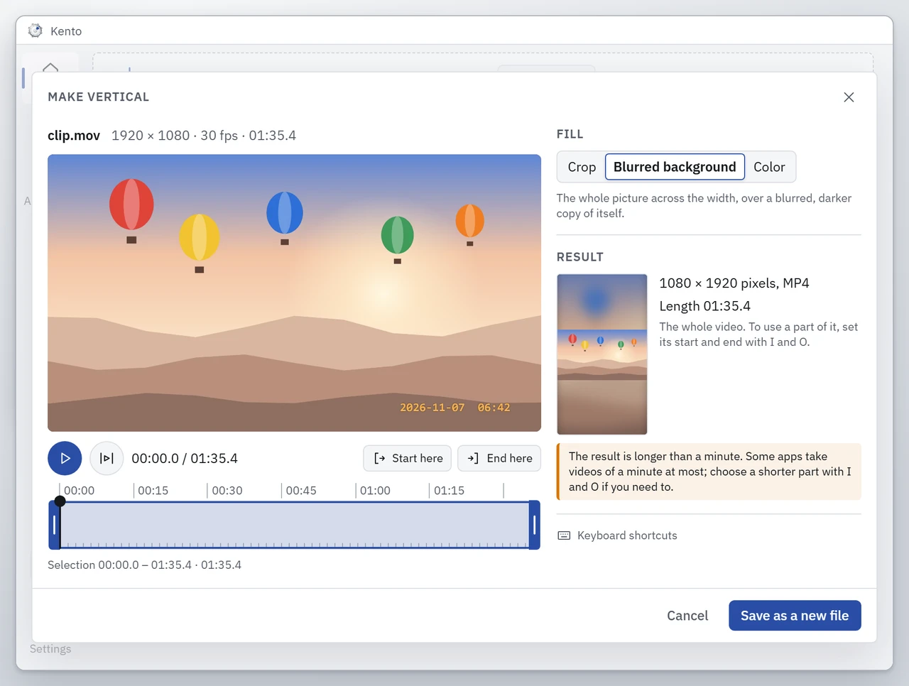<br><sub>A landscape video made vertical</sub></td>
    <td align="center">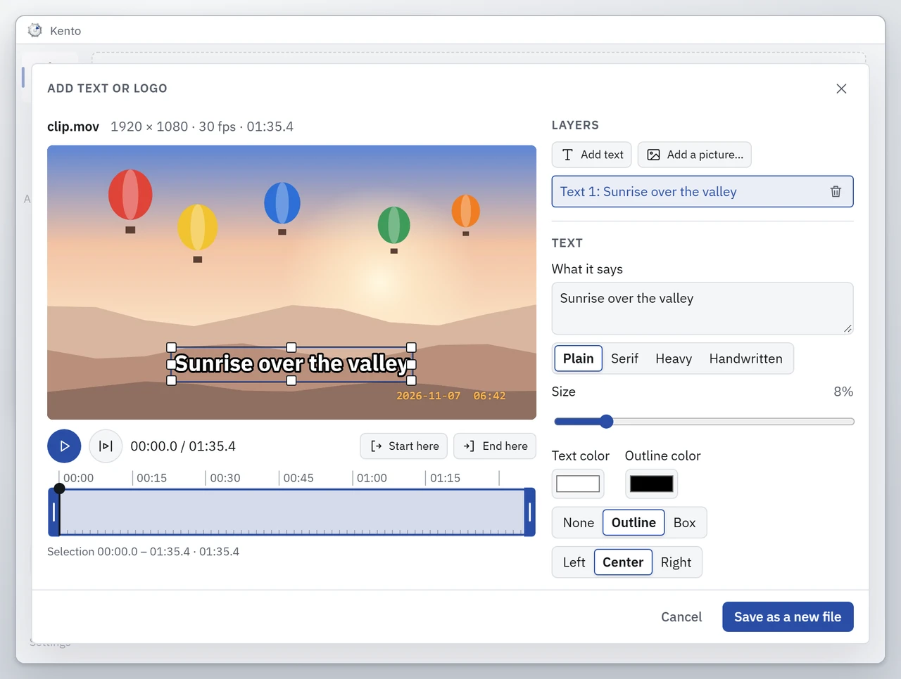<br><sub>A title over the video</sub></td>
    <td align="center">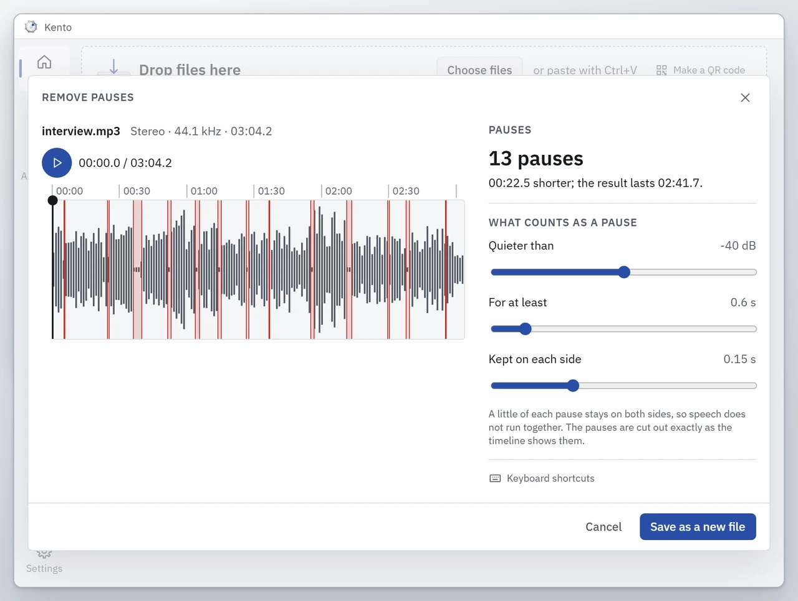<br><sub>The pauses of an interview, found</sub></td>
  </tr>
  <tr>
    <td align="center">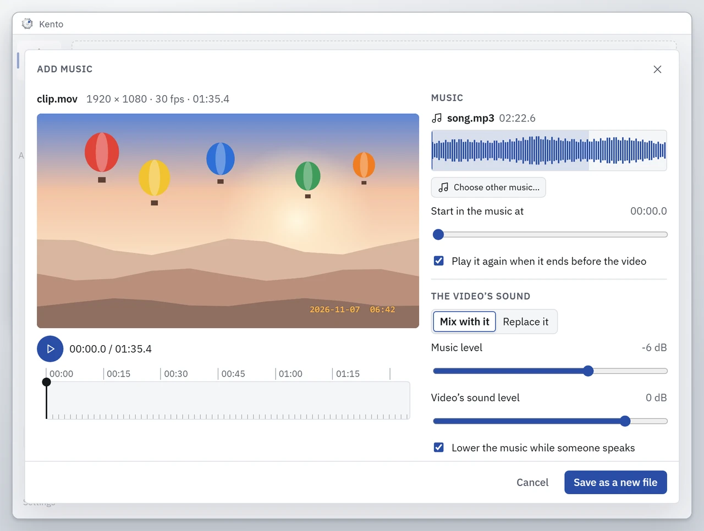<br><sub>A song under the video, quieter under speech</sub></td>
    <td align="center">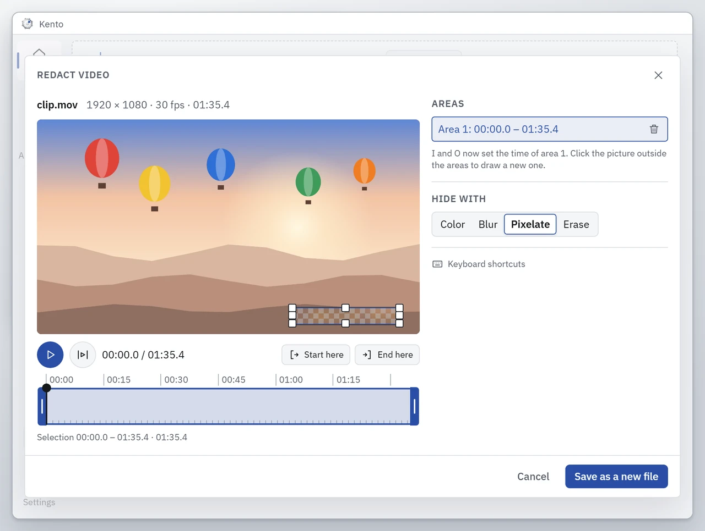<br><sub>A date stamp pixelated</sub></td>
    <td align="center">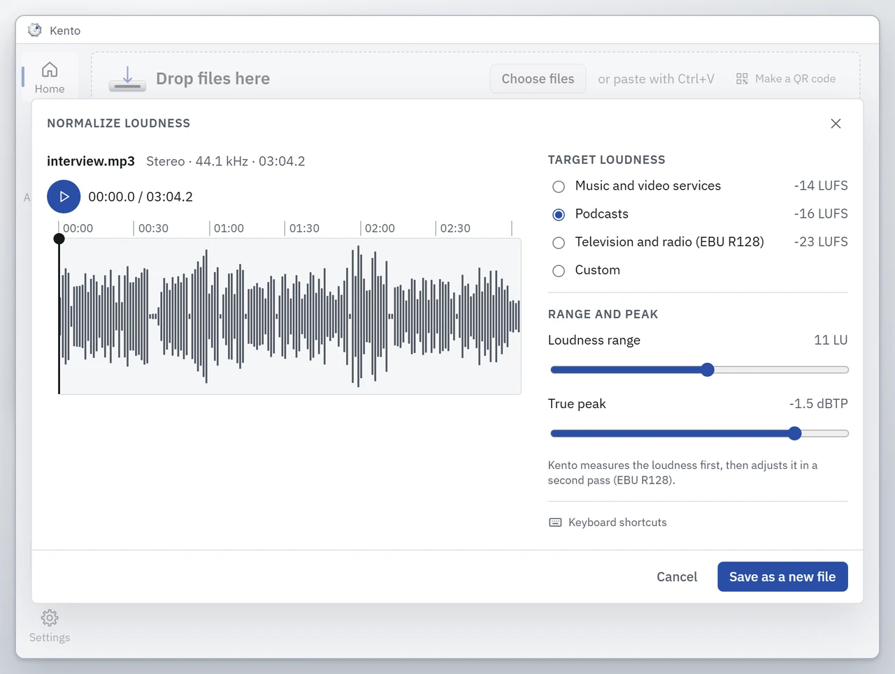<br><sub>An interview evened out for a podcast</sub></td>
  </tr>
</table>

**From the web:** paste a link, or drag it out of the browser, to save the video, only its sound, a
photo post's pictures or a thumbnail, in the quality you choose.

**Pictures:** HEIC to JPG and every other common format, crop, resize, rotate, adjust the colours,
mark up, frame, make a collage, hide parts, remove the background, read the text in a picture and
read or make QR codes.

**Documents and PDF:** office documents, spreadsheets and slides to PDF and back, slides to a
picture per slide, PDF tables to a spreadsheet; split, merge, reorder, rotate and compress PDFs, and
make one from pictures.

**On its own:** folder rules handle each new file in a folder, recipes chain steps under one name,
and the command line runs it all from scripts.

## Three keys, three wheels

| Press while dragging | Wheel | What it offers |
| --- | --- | --- |
| **Shift** | Convert | the formats every dragged file can become: HEIC to JPG, DOCX to PDF, MOV to MP4, slides to a PNG per slide… |
| **Ctrl** (⌘) | Tools | compress, crop, trim, merge, mark up, redact, metadata, remove the background, extract text, QR codes… |
| **Alt** (⌃) | File actions | share, put on shelf, copy to, move to, copy path, open in terminal, show in Explorer or Finder, archive |

- **Rings of choices.** Rest on a slice for half a second and its choices open around it: picture
  quality, one PDF or one each, page resolution, compression presets, recent folders. A plain drop
  uses the default.
- **Mixed selections.** Drag photos, PDFs and videos together: the Convert wheel shows their kinds
  first, then the formats of each.
- **Never overwrites.** Every job writes a new file next to the original; only Move, which you
  confirm, moves the original.
- **No drag needed.** Ctrl+Shift+Space opens the wheel for the files selected in Explorer or
  Finder, and the main window takes dropped, chosen or pasted files.

## More than the wheel

| | |
| --- | --- |
| **Web downloads** | Paste a link, press Ctrl+Shift+D or drag a link out of the browser: Kento asks what to download, in which quality and where. |
| **Folder rules** | A rule watches a folder and handles each new file: converts it, runs a tool or a recipe, or moves it. |
| **Recipes** | Steps under one name, such as crop to 4:5, resize to 1080 px and compress under 2 MB, on the wheel, in rules and on the command line. |
| **Library** | The last 50 files Kento made, with search, a filter by type, a preview and drag-out. |
| **Shelf** | A small tray at the edge of the screen: park files there and drag them where they belong. |
| **Command line** | The same engines and recipes for scripts: `kento convert photo.heic --to jpg`. |
| **Window layouts** | Optional shortcuts that put the front window in a half, a corner, the centre or full screen. |
| **Languages** | Twelve, Arabic right to left among them; light and dark in each. |
| **Themes** | 51 wheels to choose from: the steel dial and fifty more, from a rotary phone dial and a record player to a halved orange and a stained-glass window, each with its own colours, motion and sounds. |

## 51 themes

<p align="center">
  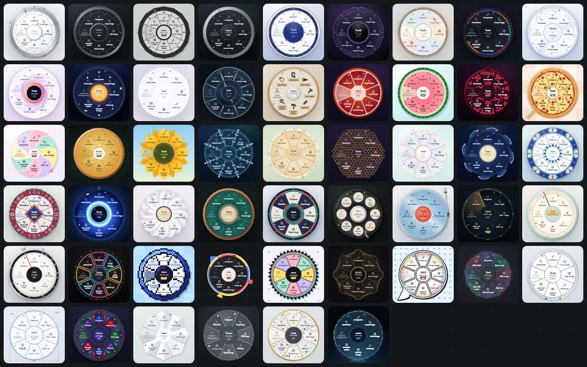
</p>

Kasa, the steel dial, is the default. The other fifty change the wheel completely, with their own
colours, motion and sounds, and give the rest of the app their colours. Each sounds like what it
shows: pointing at a slice of Karpuz takes a juicy bite, Damla drips paint, Plak crackles like a
record, Tebeşir taps chalk on the board, and applying a choice plays the theme's own finale. 51
themes, 51 sound sets. Choose one on the Themes page, which the theme at the foot of the side bar
opens; the change shows at once.

## Screenshots

<table>
  <tr>
    <td align="center">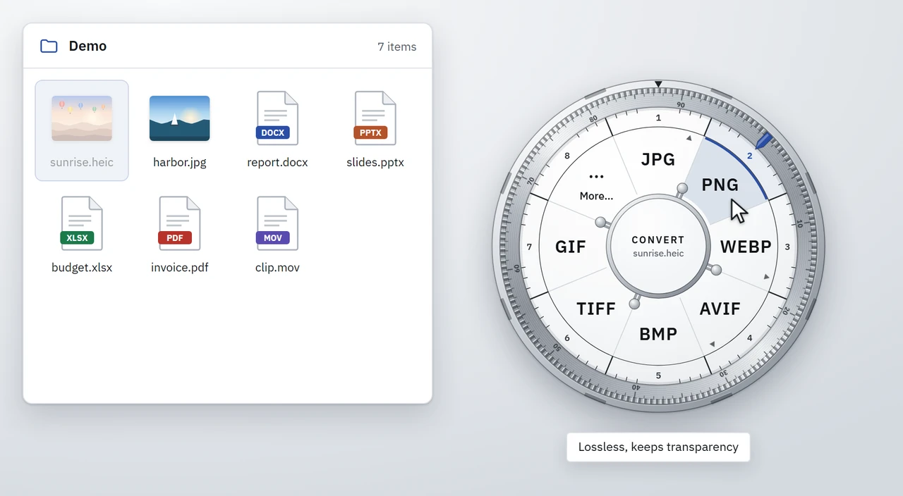<br><sub>The Convert wheel</sub></td>
    <td align="center">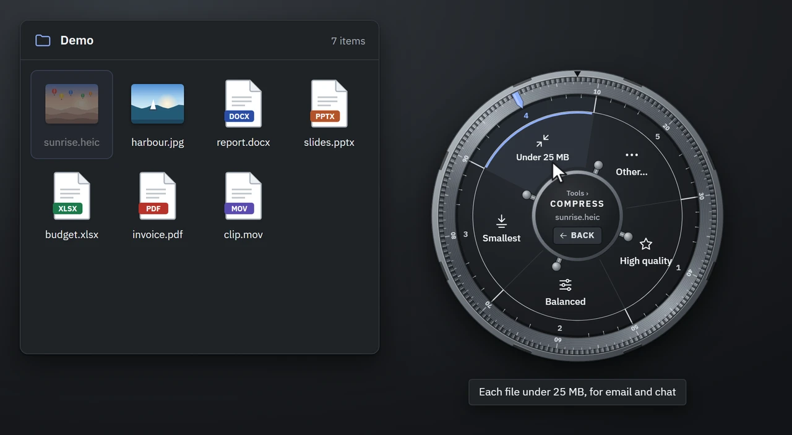<br><sub>A ring of choices on the Tools wheel, dark</sub></td>
  </tr>
  <tr>
    <td align="center">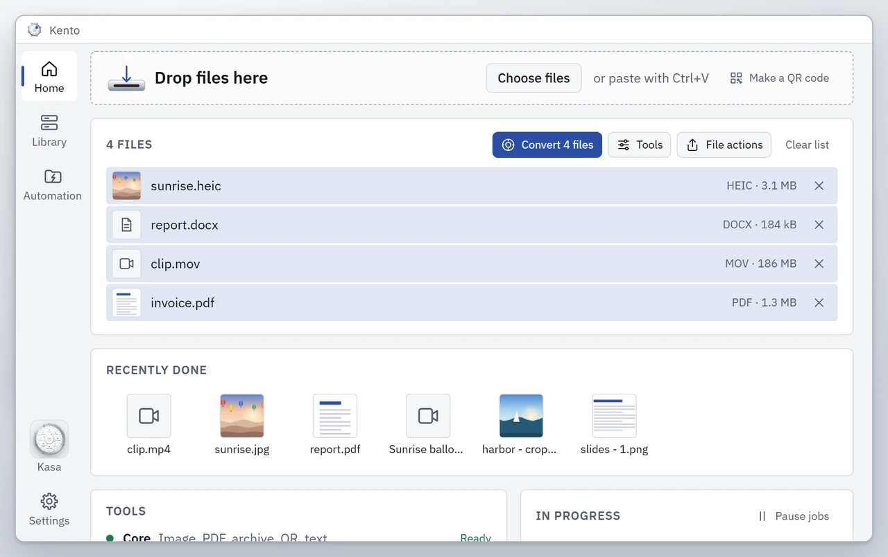<br><sub>Home</sub></td>
    <td align="center">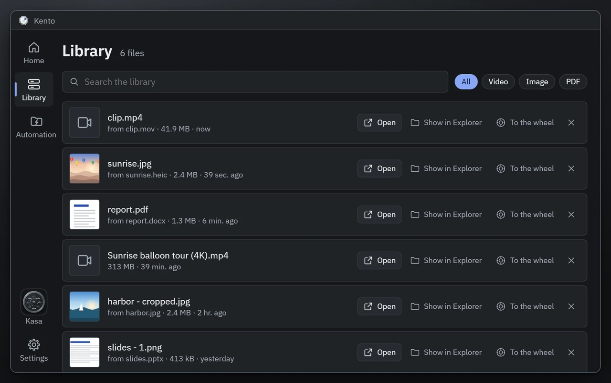<br><sub>The Library, dark</sub></td>
  </tr>
  <tr>
    <td align="center">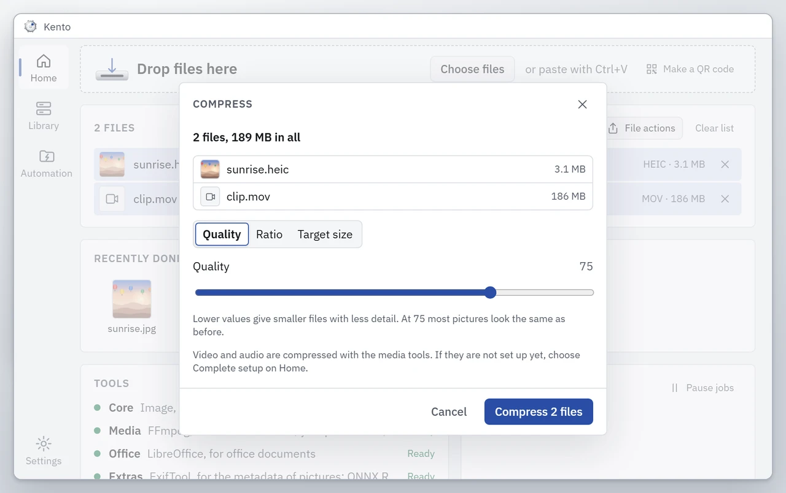<br><sub>Compress, one of the tool panels</sub></td>
    <td align="center">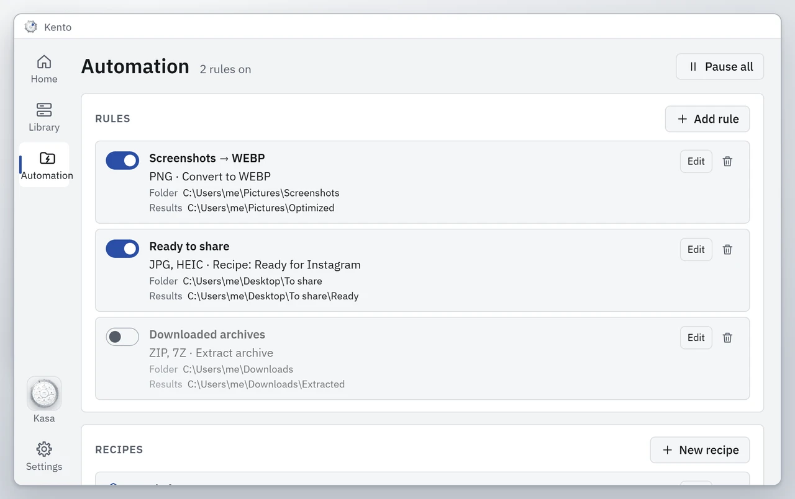<br><sub>Folder rules</sub></td>
  </tr>
</table>

## What it converts

The full list, made from the app's catalog, is in [docs/FORMATS.md](docs/FORMATS.md): 54 formats
and 355 conversion routes. In short:

| Kind | From | To |
| --- | --- | --- |
| Images | AVIF, BMP, GIF, HEIC, JPG, PNG, SVG, TIFF, WEBP | JPG, PNG, WEBP, AVIF, BMP, TIFF, GIF, PDF, ICO; HEIC where the system can write it; animated GIF to MP4, WEBM, MOV |
| Video | AVI, MKV, MOV, MP4, WEBM, WMV | each other, GIF, MP3, M4A, WAV |
| Audio | AIFF, FLAC, M4A, MP3, OGG, OPUS, WAV, WMA | each other |
| Documents | DOCX, DOC, ODT, RTF, RTFD, PAGES, TXT, MD, HTML, EPUB, TEXTCLIPPING | PDF, DOCX, ODT, RTF, TXT, MD, HTML, EPUB |
| Spreadsheets | CSV, TSV, XLS, XLSX, ODS, NUMBERS | XLSX, ODS, CSV, TSV, PDF, HTML |
| Presentations | PPT, PPTX, ODP, KEY | PDF, PPTX, ODP, a PNG or JPG per slide |
| PDF | PDF | a JPG or PNG per page, TXT, MD, XLSX (the tables), DOCX, PPTX, EPUB, HTML |
| Subtitles | SRT, VTT | SRT, VTT, TXT |
| Archives | ZIP, TAR, GZ, 7Z, RAR (read only) | ZIP, TAR, TAR.GZ, 7Z |

With no download, Kento converts pictures, archives, subtitles, plain text, Markdown and HTML,
spreadsheets to CSV, TSV, XLSX and HTML, and PDF pages to pictures, text and tables. Video and audio
need the Media tools; office documents, presentations and the other spreadsheet and PDF routes need
the Office tools (see [below](#tools-kento-downloads-on-request)). Complex documents may lose what
the new format cannot hold. On Windows, HEIC photos need Microsoft's HEIF Image Extensions or the
Media tools.

## Tools

44 tools, most of them on the Tools wheel:

| For | Tools |
| --- | --- |
| Images | Edit image (size, rotation, brightness, contrast, saturation), Mark up, Add frame, Crop image, Make a collage, Redact image, Remove background |
| PDF | Split PDF, Edit PDF (reorder, rotate and remove pages), Merge PDFs, PDF from images |
| Video | Trim video, Cut out parts, Make vertical, Add music, Add text or logo, Remove pauses, Crop video area, Change video speed, Merge videos (with transitions), Extract frames, Split video, Redact video, Fade and volume, Remove noise, Rotate video, Color and look, Reverse and loop, Stabilize video, Remove audio, Burn in subtitles |
| Audio | Normalize loudness, Trim audio, Cut out parts, Remove pauses, Fade and volume, Remove noise, Audio channels, Redact audio, Audio to video, Merge audio, Make a ringtone |
| Several kinds | Compress, Metadata, Extract text, Read QR codes, Extract archive, Make a QR code |

- **Compress** takes images, video, audio and PDF, by quality, by ratio or to a target size such as
  "under 25 MB", and never writes a file that is not smaller.
- **Metadata** views, edits and removes it; **Extract text** reads pictures and PDF pages with the
  text recognition built into Windows and macOS; **Read QR codes** writes a TXT, CSV or JSON
  report; **Extract archive** checks for harmful paths, links and archive bombs; **Make a QR code**
  makes a PNG or SVG from text or a link, on Home.
- **File actions:** Share, Put on shelf, Copy to…, Move to…, Copy path, Open in terminal, Show in
  Explorer or Finder, and Archive (ZIP, or 7Z and TAR.GZ from its ring).

## Tools Kento downloads on request

Kento itself is small. The free tools that video, audio, office files and a few extras need are
downloaded once, when you ask: on Home (**Complete setup**), in Settings → Tools, or by choosing a
dimmed slice. Each group shows its size first and installs only what is missing.

| Group | For | Tools | Licences |
| --- | --- | --- | --- |
| Media | video, audio and web downloads | FFmpeg, yt-dlp, Deno | GPL-3.0-or-later (the FFmpeg builds and the yt-dlp program), MIT (Deno) |
| Office | documents, spreadsheets, presentations | LibreOffice | MPL-2.0 |
| Extras | picture metadata, background removal | ExifTool, ONNX Runtime, the BEN2 Base model | Artistic or GPL (ExifTool, like Perl), MIT, MIT |

<details>
<summary><strong>How the tools are checked</strong></summary>

- Every file is pinned in [src-tauri/toolchain.lock.json](src-tauri/toolchain.lock.json) with its
  address, size and SHA-256, and comes from its publisher's own release. A file that fails the
  check is never run. Interrupted downloads resume.
- Tools already on your computer are used when they are recent enough (FFmpeg 6, LibreOffice 7,
  ExifTool 12, yt-dlp 2025.11.12, Deno 2.3 or newer). Settings → Tools can also point to a program
  you choose.
- The tools run as separate programs; none of them is linked with Kento's code. yt-dlp has its own
  **Update yt-dlp** button in Settings → Tools, because sites change faster than Kento's releases.
- Their versions, sources and checksums are in [docs/DEPENDENCIES.md](docs/DEPENDENCIES.md), their
  licences in [THIRD-PARTY-NOTICES.md](THIRD-PARTY-NOTICES.md).

</details>

## Download

| | |
| --- | --- |
| Windows 10 (1809 or later) and Windows 11, x64: installer | [Kento-Windows-x64-Setup.exe](https://github.com/MehmetBurakTaskaya/kento/releases/latest/download/Kento-Windows-x64-Setup.exe) |
| Windows, portable | [Kento-Windows-x64-Portable.zip](https://github.com/MehmetBurakTaskaya/kento/releases/latest/download/Kento-Windows-x64-Portable.zip) |
| macOS 13 or later, Apple silicon and Intel | [Kento-macOS-Universal.dmg](https://github.com/MehmetBurakTaskaya/kento/releases/latest/download/Kento-macOS-Universal.dmg) |

These links always lead to the newest release. Each release lists the SHA-256 of every file in
`SHA256SUMS.txt`; to compare a download, run `Get-FileHash .\Kento-Windows-x64-Setup.exe` in
PowerShell or `shasum -a 256 Kento-macOS-Universal.dmg` in Terminal.

- **Installer.** Kento installs for your user only, with no administrator rights. The installer
  fetches Microsoft Edge WebView2 when Windows lacks it (Windows 11 has it), and puts the command
  line on your PATH.
- **Portable.** Unzip it anywhere and run `kento.exe`. Your data still lives in
  `%LOCALAPPDATA%\Kento`, and the portable copy keeps itself up to date like the installed one.
- **macOS.** Open the disk image and drag Kento into Applications, where it can keep itself up to
  date.

### First launch

<details>
<summary><strong>Windows: "Windows protected your PC"</strong></summary>

Kento is not code-signed (certificates cost money; see [docs/SIGNING.md](docs/SIGNING.md)), so
SmartScreen may say "Windows protected your PC". Choose **More info → Run anyway**.

</details>

<details>
<summary><strong>macOS: Open Anyway</strong></summary>

Every Mac build is signed with the project's own certificate, but not by Apple, so Kento is not
notarised and macOS blocks its first opening:

1. Open Kento. When macOS says it cannot verify Kento, close the warning with **Done** or
   **Cancel**, whichever your macOS shows (not Move to Trash).
2. Open **System Settings → Privacy & Security**, scroll down and choose **Open Anyway** next to
   Kento. The button stays there for about an hour after you tried to open it.
3. Choose **Open Anyway** again and enter your password. From then on Kento opens like any app.

Or, in Terminal: `xattr -dr com.apple.quarantine /Applications/Kento.app`

Kento sees drags without any keyboard or input-monitoring permission. macOS asks once before Kento
may read the Finder selection for ⌃⇧Space (Automation), and Kento asks for Accessibility only if
you turn on window layouts. Updates keep these permissions, because every version is signed with
the same certificate. On Apple silicon the FFmpeg that Kento downloads runs through Rosetta 2,
which macOS offers to install the first time.

</details>

## Privacy

Conversion and editing happen on your computer: no file is uploaded, and there is no account,
analytics, telemetry or crash report. Kento goes online only to check for updates and download
them, to download a tool you agreed to install, and to download a link you asked for. It never
takes cookies from your browser and reads the clipboard only when you paste or press Ctrl+Shift+D.

<details>
<summary><strong>More about privacy</strong></summary>

- Going online also covers a newer yt-dlp when you ask for one, and for a link: reading what it
  holds, the pictures shown in the dialog and the files themselves.
- Office documents are converted with macros off, and nothing they link to is loaded from the
  internet.
- Logs stay on your computer, are rotated, and never contain what is in your files.
- Data lives in `%LOCALAPPDATA%\Kento` on Windows and `~/Library/Application Support/Kento` on a
  Mac: settings, the Library list, the shelf, recipes, rules, downloaded tools and logs. Updates
  never delete it.
- The only numbers the author sees are the download counts GitHub keeps for every release file.

</details>

## Updates

Kento keeps itself up to date, and updates are not optional: there is no Skip or Later. Every
update must carry a signature made with the project's update key, which is built into Kento, and it
installs only once the running and queued jobs have finished. Your settings, Library, shelf,
recipes, rules and tools stay.

<details>
<summary><strong>More about updates</strong></summary>

- Kento looks for a new version at start, every 6 hours, and when you ask (Settings → Updates →
  **Check now**, or Ctrl+U, ⌘U on a Mac).
- A new version downloads in the background, and its signature must be for exactly the version
  announced. Anything else is refused. How the key is kept is in [docs/SIGNING.md](docs/SIGNING.md).
- Once it is downloaded, no new job starts. Running and queued jobs finish, then Kento says so,
  restarts and installs the new version.
- Without a connection Kento keeps working, and updates at the first check after the connection
  returns.
- The check reads one small file, `latest.json`, from this repository's newest release on GitHub.
  It sends nothing about you, your computer or your files; GitHub sees the request like any
  download.
- The notes of the new version appear on its first start.

</details>

## How to use it

<details>
<summary><strong>The wheel</strong></summary>

Drag one or more files, and while you drag, press a key:

| Wheel | Windows | macOS |
| --- | --- | --- |
| Convert | Shift | Shift |
| Tools | Ctrl | ⌘ |
| File actions | Alt | ⌃ |

- The wheel stays open when you let go of the key: keep dragging and drop the files on a slice.
  Esc, or dropping outside the wheel, cancels. Another key switches to its wheel.
- The Convert wheel shows only the formats every selected file can become. A mixed selection shows
  its kinds first: rest on one to open it.
- **Rings of choices.** Rest on a slice for half a second and its choices open around it: picture
  quality, one PDF or separate PDFs, resolution, presets, recent folders and more. A plain drop
  uses the default; resting on the hub goes back.
- With the keyboard: Up and Down move, Right or Enter opens a slice's choices or applies it,
  Left, Esc or Backspace go back, Space applies, Tab closes.
- Every job writes a new file next to the original: `photo.heic` becomes `photo.jpg`, or
  `photo (2).jpg` when that name is taken. Tools add a word: `video - trimmed.mp4`. Kento never
  overwrites a file; only Move, which you confirm, moves the original. Settings → Output can send
  everything to one folder instead.
- The keys can be changed in Settings → Wheel.
- **Themes.** The steel dial, Kasa, is one of 51 themes, each a wheel of its own with its own
  colours, motion and sounds: a rotary phone dial, a record player, a halved orange, an İznik tile
  rosette, a stained-glass rose window and many more. The Themes page, opened from the theme at the
  foot of the side bar or from Settings → Appearance, shows them all in light or dark with a wheel
  to try; the one you choose colours every window at once.

On Windows, a drag that starts in a program running as administrator cannot be seen by Kento,
because Windows keeps the two apart. Please do not run Kento as administrator to get around it.

</details>

<details>
<summary><strong>Without dragging: shortcuts, Home, Library and Settings</strong></summary>

- **Ctrl+Shift+Space** (⌃⇧Space on a Mac) opens the wheel at the pointer for the files selected in
  Explorer or Finder. When none of them converts, the file actions open.
- **Ctrl+Shift+D** (⌃⇧D) downloads the link on the clipboard. While it is on, the browser's own
  Ctrl+Shift+D does not reach the browser; Settings can turn it off.
- **Home** (Ctrl+1): drop files, choose them (Ctrl+O) or paste them (Ctrl+V). Pasted text becomes a
  `.txt` file, a pasted picture a `.png`, and a pasted link starts a download. In the file list,
  Enter opens the Convert wheel, Ctrl+Space the tools and Alt+Enter the file actions; Delete takes a
  file off the list, never off the disk. Home also shows what was done lately, the tools' state and
  the running jobs.
- **Library** (Ctrl+2): the last 50 files Kento made, with search (Ctrl+F), a filter by type, a
  preview, Show in Explorer or Finder, dragging out and sending to the wheel.
- **Automation** (Ctrl+3): folder rules and recipes.
- **Settings** (Ctrl+,).
- **Explorer** (Windows): Kento can add itself to the Send To menu and to the right-click menu.
  Both stay off until you turn them on in Settings → Explorer.

On a Mac the window shortcuts use ⌘ instead of Ctrl. Closing the window leaves Kento in the
notification area (the menu bar on a Mac), where its menu opens Home and Settings, pauses the jobs
and quits.

</details>

<details>
<summary><strong>The shelf</strong></summary>

**Put on shelf**, in the file actions, puts files on Kento's shelf: a small window at the edge of
the screen. Go to another folder and drag them from the shelf to where they belong. The shelf keeps
a reference to each file, not a copy (Settings → Shelf can keep a copy), and shows when a file was
moved or deleted. Its history can be searched, and its files sent to the wheel or shown in Explorer
or Finder.

</details>

<details>
<summary><strong>Web downloads</strong></summary>

Paste a link on Home, press Ctrl+Shift+D with a link copied, or drag a link or a video from the
browser with a key held (or drop it on Home): Kento asks what to download (the video, only its
audio, the original, a YouTube thumbnail, the chosen pictures of a photo post), in which quality
and into which folder. Content behind DRM or a sign-in, live streams, whole profiles and playlists
are not supported, and Kento never takes cookies from your browser. Only download what you have the
right to download.

</details>

<details>
<summary><strong>Automation and recipes</strong></summary>

A **rule** watches a folder and handles each new file that lands in it: it converts the file, runs a
tool or a recipe on it, or moves it, and puts the result where you choose. For example, PNGs that
land in Screenshots become WEBP files in Optimized. Kento waits until a file is fully written, never
handles its own results again, and keeps an activity log.

A **recipe** chains steps under a name, such as "Instagram": crop to 4:5, resize to 1080 px and
compress under 2 MB. Recipes appear on the wheel's Favorites slice, in rules and on the command
line.

</details>

<details>
<summary><strong>Window layouts</strong></summary>

Off until you turn them on in Settings → Window layouts. Then shortcuts place the window in front,
and with nothing selected Ctrl+Shift+Space opens a Window ring. No shortcut uses the Windows key,
so Windows Snap stays as it is.

| Layout | Windows | macOS |
| --- | --- | --- |
| Left or right half | Ctrl+Alt+← / → | ⌃⌥⌘← / → |
| Full screen | Ctrl+Alt+↑ | ⌃⌥⌘↑ |
| Center | Ctrl+Alt+↓ | ⌃⌥⌘↓ |
| Top left or top right | Ctrl+Alt+Home / Page Up | ⌃⌥⌘U / I |
| Bottom left or bottom right | Ctrl+Alt+End / Page Down | ⌃⌥⌘J / K |

</details>

<details>
<summary><strong>Languages</strong></summary>

Kento speaks twelve languages and follows the system's language; Settings → Language changes it at
once, in every window: English, Turkish, Spanish, Simplified Chinese, Japanese, German, French,
Brazilian Portuguese, Arabic (right to left), Korean, Italian and Russian. English and Turkish are
checked by hand; the other ten are new and wait for a native speaker's review. Corrections are
welcome: see [CONTRIBUTING.md](CONTRIBUTING.md).

</details>

## Command line

<details>
<summary><strong>Convert, run tools and recipes from a terminal</strong></summary>

```sh
kento convert photo.heic --to jpg
kento convert report.docx notes.md --to pdf --out PDFs
kento tool compress video.mp4 --target-size 25MB
kento tool merge-pdf part1.pdf part2.pdf
kento tool merge-video a.mp4 b.mp4 --transition fade --seconds 1
kento recipe run Instagram photo.jpg
kento routes heic
```

The command line runs the same engines, recipes and naming rules as the app, without opening a
window. Results go next to each file, or into the `--out` folder, which Kento creates when needed.

| Command | Does |
| --- | --- |
| `kento convert FILES… --to FORMAT` | converts each file |
| `kento tool TOOL FILES…` | runs a tool: `compress` (`--quality 1–100`, `--ratio 5–95` or `--target-size`), `mute`, `normalize`, `denoise` (`--strength light\|medium\|strong`, `--rumble`), `remove-pauses` (`--threshold DB`, `--min-length S`, `--keep S`), `stabilize` (`--strength`), `rotate-video` (`--turn right\|left\|half`, `--mirror`, `--flip`), `merge-video` (`--transition fade\|fade-black\|slide\|wipe`, `--seconds 0.2–2`), `merge-audio` (`--crossfade 0–10`), `extract`, `merge-pdf`, `images-to-pdf` (`--page fit\|a4\|letter`, `--margin`), `read-qr` (`--format txt\|csv\|json`) |
| `kento recipe list`, `kento recipe run RECIPE FILES…` | lists or runs your recipes |
| `kento formats`, `kento routes FORMAT` | lists the formats, or what one converts to and from |
| `kento help COMMAND` | explains a command |

Options: `-o`/`--out FOLDER`, `--json` (the result as one JSON document), `-q`/`--quiet`,
`-h`/`--help`, `-V`/`--version`. Exit codes: 0 done, 1 a job failed, 2 wrong usage, 3 not possible,
4 a tool is missing, 130 cancelled (Ctrl+C cancels the job and removes its partial output). The
tools that need choices in a window (the editors, for example) are not on the command line.

- **Windows:** `kento.com` sits beside `kento.exe`, and the installer adds its folder to your
  user's PATH, so `kento` works in any new terminal. With the portable ZIP, run it from its folder
  or add the folder to your PATH yourself.
- **macOS:** the command line is `Kento.app/Contents/MacOS/kento-cli`. Link it into a folder on your
  PATH to type `kento`:

  ```sh
  sudo mkdir -p /usr/local/bin
  sudo ln -sf /Applications/Kento.app/Contents/MacOS/kento-cli /usr/local/bin/kento
  ```

</details>

## Build from source

You need Node.js 24, the stable Rust toolchain (on Windows with the Visual Studio Build Tools and
their C++ workload; on macOS with the Xcode Command Line Tools) and, on Windows, WebView2, which
Windows 10 and 11 already have.

```sh
npm ci
npm run pdfium                        # the pinned PDFium library Kento ships with
npm run tauri dev                     # run Kento with live reload
npm run tauri build -- --no-bundle    # release builds of kento and kento-cli in src-tauri/target/release
```

A full build with the installer or the disk image also signs the update files, so it needs
`TAURI_SIGNING_PRIVATE_KEY`; for a local test, a throwaway key from `npx tauri signer generate`
will do. Releases are described in [docs/RELEASING.md](docs/RELEASING.md).

<details>
<summary><strong>What CI checks</strong></summary>

CI runs these on Windows and macOS for every push and pull request:

```sh
npm run typecheck
npm run lint
npm run format:check
npm test
npm run check:i18n
npm run check:spdx
npm run check:licenses
npm run check:third-party
cargo fmt --all --manifest-path src-tauri/Cargo.toml --check
cargo clippy --manifest-path src-tauri/Cargo.toml --workspace --all-targets -- -D warnings
cargo test --manifest-path src-tauri/Cargo.toml --workspace
```

plus `cargo deny check` in `src-tauri`, a check that [docs/FORMATS.md](docs/FORMATS.md) matches the
catalog (`npm run catalog:export` writes it), a release build, `kento --smoke-test` and a run of the
command line. [CONTRIBUTING.md](CONTRIBUTING.md) explains which tests need FFmpeg, LibreOffice and
the other tools.

</details>

The design system is in [design/DESIGN.md](design/DESIGN.md), the specification in
[docs/SPEC.md](docs/SPEC.md) and the structure of the code in
[docs/ARCHITECTURE.md](docs/ARCHITECTURE.md). The demos above and the screenshots are recorded from
the app itself with `npm run demo`.

## Contributing

Issues and pull requests are welcome; for larger changes, please open an issue first.
[CONTRIBUTING.md](CONTRIBUTING.md) explains how. Please report security problems privately, as
[SECURITY.md](SECURITY.md) describes. Everyone taking part follows the
[Code of Conduct](CODE_OF_CONDUCT.md).

## Licence

[MIT](LICENSE) © 2026 Mehmet Burak Taşkaya. Kento is built on open-source packages, listed with
their licences in [THIRD-PARTY-NOTICES.md](THIRD-PARTY-NOTICES.md) and with their versions and
checksums in [docs/DEPENDENCIES.md](docs/DEPENDENCIES.md).

---

<p align="center">Made by Mehmet Burak Taşkaya · <a href="https://mehmetburaktaskaya.com">mehmetburaktaskaya.com</a></p>
